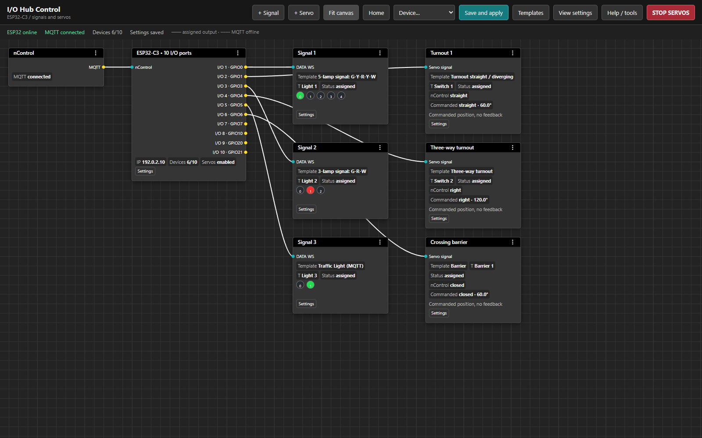
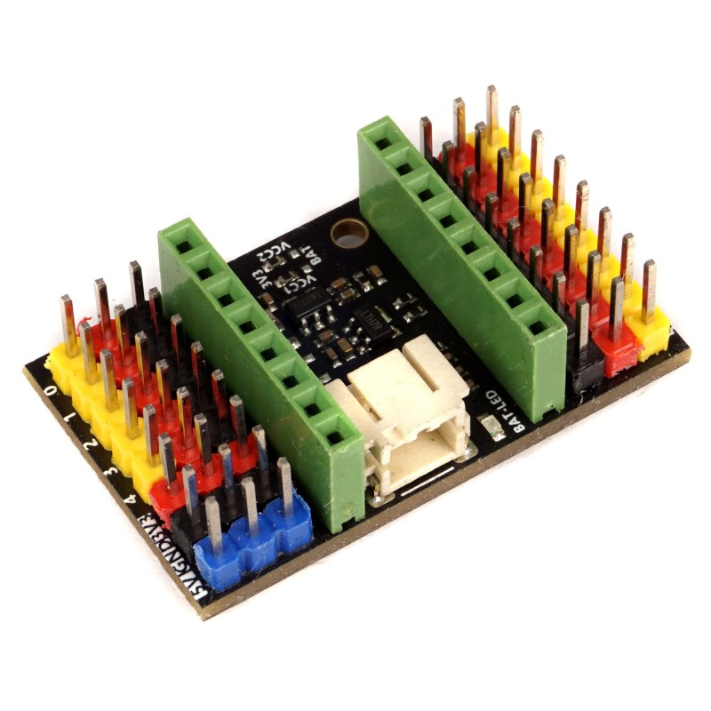

# I/O Hub Control

ESP32 firmware for **nControl model railway control through MQTT**. Configure
signal heads, turnout servos and physical I/O assignments using an offline node
editor served by the ESP32.

**This edition:** ESP32-C3 SuperMini, up to ten WS signal heads/servos in total.

## Features

- Up to **10 devices total**: WS signal heads with 1–5 lamps, servos, or a mix.
- Six hardware LEDC servo channels plus four timer ISR PWM outputs at **50 Hz**.
- Two RMT TX channels multiplexed across up to ten independent signal DATA pins.
- WS2812B RGB, SK6812 RGB and SK6812 RGBW; RGB/GRB or RGBW/GRBW order.
- Shared editable signal/turnout templates, colors, blinking and servo angles.
- Straight/diverging, three-way and wye turnouts, barriers, and nine imported
  nControl signal-head profiles. Original state codes remain case-sensitive.
- Offline graph editor, mobile layout, diagnostics, calibration, action previews,
  separate physical tests, import/export, setup AP, mDNS and automatic reconnect.
- Versioned JSON and two NVS slots with generation, CRC and read-back checks.
  MQTT state updates never write to flash. Ordinary reads mask passwords.

## Web interface

An offline node editor with a dark canvas, a 24 px grid, compact controls,
sidebar settings and explicit **Save and apply** for configuration changes.

The interface, help and diagnostics are in English. Everything is served locally
by the ESP32; no CDN or internet connection is needed at runtime. Renaming a node
does not change its MQTT label. The nControl and ESP32 root nodes are protected
against deletion.



*Documentation preview with sample values; no physical outputs are operated.*

## Hardware

Hardware used: **ESP32-C3 SuperMini** with an
**ESP32-C3 Super Mini Breakout Expansion Board**.



Allowed processor GPIO numbers: **0, 1, 2, 3, 4, 5, 6, 7, 8, 9, 10, 20, 21**.
Default I/O 1–10 map: **0, 1, 3, 4, 5, 6, 7, 10, 20, 21**. These are GPIO numbers,
not connector positions. GPIO18/19 are excluded and can serve native USB.

GPIO2/8/9 are boot strapping pins and unassigned by default. GPIO8 may carry an
onboard LED and GPIO9 the BOOT button; SuperMini variants differ. External
circuits must preserve boot levels. GPIO20/21 require UART0 to be released;
GPIO4–7 must not be used by an external JTAG debugger while assigned to outputs.
Reset-time output pulses cannot be ruled out.

The first six servos use LEDC, with at most four distinct frequencies. Servos
7–10 use a timer interrupt at 50 Hz, **not additional LEDC channels**. Software
PWM jitter needs measurement under Wi-Fi/MQTT/LED load. No PWM expander is needed.

Power servos and LEDs from suitable separate supplies and connect their ground
to ESP32 GND. Never power them from GPIO or the board's 3.3 V output. Connect
servo signal to its assigned GPIO; WS DATA goes to the first LED's DIN, then
DOUT to the next DIN. A 3.3 V DATA signal is not guaranteed for a 5 V LED input;
use a suitable fast level shifter, such as 74AHCT125, when needed.

## First use

1. Join **IO-Hub-xxxxxx-setup**, password **ncontrol-setup** (the fixed setup
   password; no private credentials are included in this repository).
2. Open `http://192.168.4.1/` and the ESP32 node's **Settings**.
3. Set Wi-Fi and nControl's MQTT broker address; default port **1883**, optional
   username/password. Click **Save and apply**.
4. Open the LAN IP or `http://io-hub-control-<last six MAC digits>.local/`.

The MQTT Client ID uses the full MAC suffix. nControl discovery displays
`I/O Hub Control - <suffix>`. Keep identities unique for each ESP32; boards may
share a broker and state topic but keep independent output configurations.
Wi-Fi failure makes the setup AP available without blocking output processing.

### Turnout and servo

1. Click **+ Servo**, then connect an ESP32 I/O output to the device input.
2. Select **Turnout straight / diverging**, source T and the exact nControl label,
   for example `Turnout1`. Case matters.
3. Set the template angles (defaults: `s` → 60°, `t` → 120°). Servo defaults are
   50 Hz and 1000–2000 microseconds; calibrate for your mechanism.
4. **Save and apply**. Saving does not command an angle and disables MQTT movement.
5. **Help / tools → Enable servo movement**, then change the turnout in nControl.
   **Apply cached states to servos** separately commands the last received state.

```text
T|Turnout1|s
T|Turnout1|t
```

Manual test: **Settings → Servo calibration → Enter without movement**, select
an angle, then explicitly confirm **Perform physical movement**. Finish
calibration before MQTT control. The node shows the received state and commanded
target separately; neither is mechanical feedback. Three-way, wye and barrier
states have English descriptions too.

### Red/green signal

Click **+ Signal**, select **Traffic Light (MQTT)** (`nc-classic-RG`), connect an
I/O output and assign `Signal1`. This profile uses **LED 0 red, LED 1 green**.
`r` lights only red, `g` only green, `rf`/`gf` blink the corresponding lamp and
`o` turns both off. Other heads have different lamp orders. Edit or duplicate a
template to match your hardware.

```text
T|Signal1|r
T|Signal1|g
T|Signal1|gf
T|Signal1|o
```

For three identical heads, reuse one template with three device labels and I/O
outputs. Edit the shared template once, then save to update all assignments.
GPIO and MQTT source remain per device.

## MQTT compatibility

Subscribe to **nControl/websocket/rx**: this is where nControl publishes states.
After all subscriptions are acknowledged, send **W|ST** once to
**nControl/websocket/tx**. Reconnect repeats subscription and synchronization.
Synchronization does not guarantee a response for standalone tracks without tiles.

Messages: `T|label|state` or `S|internal-segment-index|numeric-state`. UTF-8, case
and commas are preserved; callback buffers need not end in NUL. Unknown types,
topics and invalid payloads are ignored. Duplicate states do not restart servo
travel or blinking. Missing periodic states do not indicate a broker failure.

Prefer T labels: S indices can change when editing a layout. A Crossover that
publishes `l` for both positions needs S or another correct source; firmware does
not guess. State meanings belong to the selected template.

nControl publishes T/S in Simulation too. Servo permission starts disabled and
enabling it does not apply cache automatically. An optional custom permission
topic accepts OPERATIONAL/SIMULATION/DESIGN and requires nControl configuration;
it is not a standard mode feed. Disabling PWM does not physically hold a load.

Discovery uses retained QoS 1 metadata/status at
`nControl/nodes/<node_id>/info` and `/status`, with an offline Last Will.

## Output behavior

Servo movement from MQTT starts disabled. Saving configuration disables it again
and does not command a new angle. Enable movement explicitly; applying cached
states is a separate action. Calibration blocks MQTT for the selected servo.

The node shows the received nControl state and commanded servo target separately;
there is no mechanical feedback. Restart/offline policies are configurable.
Disabling PWM does not hold a physical load. Repeated states do not restart travel
or blinking. Signal rendering continues independently of servo permission.

## Build and upload

Python 3.11+ and Node.js 18+ are recommended. Pinned versions:

| Component | Version |
|---|---|
| PlatformIO Core | 6.1.18 |
| Espressif32 / Arduino-ESP32 | 6.9.0 / 2.0.17 |
| ArduinoJson | 6.21.5 |
| AsyncMqttClient / AsyncTCP | 0.9.0 / 1.1.1 |
| BaklavaJS / Vue | 2.8.1 / 3.5.22 |
| esbuild | 0.25.10 |

```sh
python -m pip install -r requirements-dev.txt
python -m platformio pkg install -e supermini
npm --prefix web-editor ci
node web-editor/test.cjs
node web-editor/test-servo-status.cjs
node web-editor/build.cjs
python tools/test_core.py
python -m platformio run -e supermini
python -m platformio run -e supermini -t buildfs
python -m platformio device list
```

The `supermini` environment uses `esp32-c3-devkitm-1` for the processor, explicitly
sets 4 MB flash, native USB and a custom partition layout. Check the connected
processor/port, then replace COMx with its actual port (or Linux/macOS path):

```sh
python -m platformio run -e supermini -t upload --upload-port COMx
python -m platformio run -e supermini -t uploadfs --upload-port COMx
python -m platformio device monitor --port COMx --baud 115200
```

**Upload firmware and LittleFS.** All web assets are served from ESP32 without
CDN/cloud dependencies. Prebuilt `data/index.html` is committed; npm is only
needed when rebuilding the panel. Upload boards one at a time.

Offsets: bootloader `0x0`, partition table `0x8000`, application `0x20000`,
LittleFS `0x220000`. The PlatformIO hook removes stock Arduino `boot_app0` at
`0xe000`, which would overlap this project's NVS. Do not erase flash when
preserving settings. See [the detailed guide](docs/HUB-IO-V2.md) for ROM upload.

## Configuration and testing

Schema: [config.schema.json](config.schema.json). Examples use placeholder Wi-Fi,
a sample broker and blank passwords; edit before importing. Import/backup loads
a draft; only **Save and apply** changes persistent settings and physical
assignments. Ordinary export hides passwords; secret export is separate.

Limits: 24 KiB JSON, 24 templates, 128 states and 320 lamp definitions. Version 1
is still supported; migration is reviewed in the browser before saving. See
[legacy notes](docs/README-v1.md) and [verification notes](docs/VERIFICATION.md).

```sh
python tools/preview_panel.py --port 8765
```

Open `http://127.0.0.1:8765/` for a mock preview with no hardware, MQTT or saving.
Host tests exercise actual C++ parser, validators, output scheduler and NVS with
hardware stubs. Dedicated UTF-8 fixtures intentionally retain non-English text.
Optional browser tests use Playwright and installed Chrome:

```sh
npm --prefix web-editor install --no-save --package-lock=false playwright@1.62.1
node web-editor/ui-test.cjs
```

Third-party UI notices are included in source and generated HTML. Hardware
references: [ESP32-C3 datasheet](https://documentation.espressif.com/esp32-c3_datasheet_en.html)
and [LEDC documentation](https://docs.espressif.com/projects/esp-idf/en/stable/esp32c3/api-reference/peripherals/ledc.html).

## Source layout

| Path | Responsibility |
| --- | --- |
| `src/main.cpp` | Wi-Fi, MQTT, HTTP API, discovery and configuration application |
| `include/protocol.h` | Length-limited UTF-8 T/S parser |
| `include/config.h`, `include/ports_config.h` | Schema and resource validation |
| `include/outputs.h`, `include/servo_extra.h` | LEDC, timer PWM and RMT scheduling |
| `include/store.h` | Two-slot NVS persistence |
| `web-editor/src/` | English node editor source |
| `data/index.html` | Generated offline panel |
| `examples/` | Credential-free example configurations |
| `test/`, `tools/` | Host tests, preview, build and packaging tools |

Detailed instructions: [I/O guide](docs/HUB-IO-V2.md).
